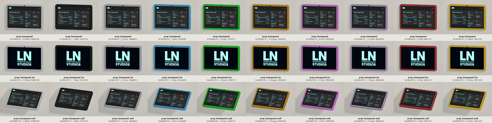

# iFruit Home Panel

Lore-friendly tablet and wall-mounted home panel props for FiveM, featuring iFruit (GTA branding).
Did it for my server currently using [LNS_Housing](https://github.com/LumaNodeStudios/LNS_Housing) and decide to release it 😊

Each wall variant is a single prop with the tablet and mount already aligned. Place only the wall model.

**Note:** *All screens use the [LNS_Housing](https://github.com/LumaNodeStudios/LNS_Housing) UI, but you can change it to whatever you want.*

## Previews

## Model names and hashes

- `prop_homepanel` - `0x1E64AE16` (Standard HomePanel)
- `prop_homepanel_lns` - `0xC8025761` (LNS screen)
- `prop_homepanel_wall` - `0x4AEB4F7D` (Wall mount)

## Tint colours

All three models use the same tint indices. The display and LED do not change colour.

- `0` - White (`#DBDCDE`)
- `1` - Black (`#262729`)
- `2` - Silver (`#BABDC2`)
- `3` - Blue (`#52AEDB`)
- `4` - Green (`#29CF31`)
- `5` - Orange (`#D69A29`)
- `6` - Pink (`#DE82DB`)
- `7` - Purple (`#BDA6C8`)
- `8` - Red (`#B5413F`)
- `9` - Yellow (`#EFC339`)

**Let me know if you run into any issues or please open an issue and give a star**
